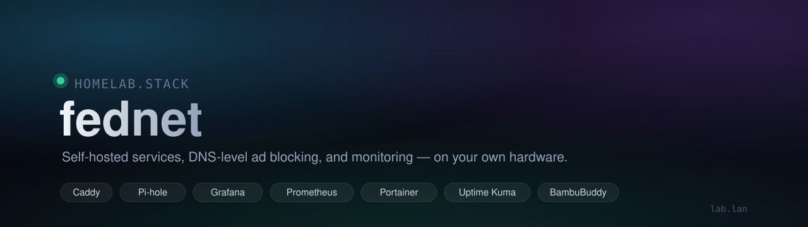
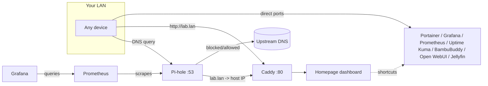
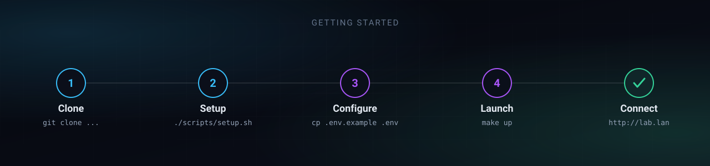

<p align="center">
  
</p>

<p align="center">
  
  
  
  
  
</p>

# fednet

A Docker Compose homelab stack: a reverse-proxied dashboard with live
service widgets, network-wide ad blocking, container management,
metrics/monitoring, encrypted backups, and a 3D-printer control panel —
all self-hosted on one box, reachable either over Tailscale or a plain LAN
hostname.

Nothing here is exposed to the public internet. Every service binds to the
host's LAN interface (or a Tailscale tailnet, if you set one up); there's no
port-forwarding, no cloud dependency, and no external accounts required to
run it.

## Features

- **One dashboard, live data** — Homepage shows real-time container
  CPU/mem/status, Pi-hole's blocked-today count, Portainer's running
  container count, and Uptime Kuma's up/down summary, right on each
  service's card — no need to click through to check anything
- **DNS-level ad blocking** for the whole LAN via Pi-hole, with curated
  blocklists and a watchdog that alerts if they go stale
- **Encrypted, automated backups** — restic snapshots everything that
  isn't already in git (service data, secrets, external volumes) on a
  schedule, with retention policy and failure alerting built in
- **Zero-touch service discovery** — add a new `services/*.yml` file and
  `make up` picks it up automatically, no other file to edit
- **Reachable your way** — a local `lab.lan` hostname via Pi-hole's own
  DNS, or a Tailscale tailnet for access from anywhere, your choice (or
  both)
- **Local AI chat** — Ollama + Open WebUI for a self-hosted,
  nothing-leaves-the-LAN alternative to a hosted AI chat product
- **Media server** — Jellyfin, on the same dashboard as everything else

## Table of contents

- [Features](#features)
- [Stack overview](#stack-overview)
- [Architecture](#architecture)
- [Prerequisites](#prerequisites)
- [Setup](#setup)
  - [1. Clone and run one-time host setup](#1-clone-and-run-one-time-host-setup)
  - [2. Configure environment](#2-configure-environment)
  - [3. Start the stack](#3-start-the-stack)
  - [4. Give it a hostname](#4-give-it-a-hostname)
- [Service notes](#service-notes)
- [Dashboard customization](#dashboard-customization)
- [Theming](#theming)
- [Adding a new service](#adding-a-new-service)
- [Commands](#commands)
- [Local AI chat (Ollama + Open WebUI)](#local-ai-chat-ollama--open-webui)
- [Jellyfin](#jellyfin)
- [Backups](#backups)
- [Honeypot](#honeypot)
- [DNS flood detection](#dns-flood-detection)
- [Hourly Pi-hole stats digest](#hourly-pi-hole-stats-digest)
- [Troubleshooting](#troubleshooting)
- [Data & persistence](#data--persistence)

## Stack overview

| Service | Purpose | Default port |
|---|---|---|
| [Caddy](https://caddyserver.com/) | Reverse proxy, front door for the dashboard | `80`, `443` |
| [Homepage](https://gethomepage.dev/) | Dashboard with shortcuts to every service | behind Caddy on `80` |
| [Portainer](https://www.portainer.io/) | Container management UI | `9000` |
| [Pi-hole](https://pi-hole.net/) | Network-wide DNS ad blocking + local DNS records | `53` (DNS), `8081` (admin) |
| [Uptime Kuma](https://github.com/louislam/uptime-kuma) | Service uptime monitoring | `3001` |
| [Grafana](https://grafana.com/) | Dashboards for metrics | `3000` |
| [Prometheus](https://prometheus.io/) | Metrics collection | `9090` |
| [BambuBuddy](https://github.com/maziggy/bambuddy) | Self-hosted Bambu Lab 3D printer dashboard | `8000` (host networking) |
| [Ollama](https://ollama.com/) | Local LLM inference server | `11434` |
| [Open WebUI](https://github.com/open-webui/open-webui) | Browser chat UI for Ollama | `8082` |
| [Jellyfin](https://jellyfin.org/) | Self-hosted media server | `8096` |

Every service except BambuBuddy sits on a shared external Docker network
(`edge`) and is published directly on the host's LAN ports — Caddy only
proxies the Homepage dashboard itself on port 80. BambuBuddy runs with
`network_mode: host` instead, because printer auto-discovery (SSDP) and its
RTSP camera proxy both need raw L2 network access a bridge network can't
provide.

## Architecture



## Prerequisites

- A Linux host on your LAN with [Docker](https://docs.docker.com/engine/install/) and the Compose plugin installed
- `make`
- Root/sudo on that host (Pi-hole binds port 53, Caddy binds 80/443)
- Optional: a [Tailscale](https://tailscale.com/) account, if you'd rather reach the stack over a tailnet than a LAN hostname

## Setup

<p align="center">
  
</p>

### 1. Clone and run one-time host setup

```bash
git clone https://github.com/imfronto/fednet.git
cd fednet
./scripts/setup.sh
```

`scripts/setup.sh` creates the shared `edge` Docker network, the `data/`
subdirectories every service's volumes expect, and offers to install
Tailscale if it isn't already present. It's idempotent — safe to re-run.

### 2. Configure environment

```bash
cp .env.example .env
```

Then edit `.env`:

| Variable | Required | Notes |
|---|---|---|
| `TZ` | recommended | Your timezone, e.g. `America/Detroit` |
| `PUID` / `PGID` | recommended | Match your host user so bind-mounted files aren't root-owned |
| `DOCKER_GID` | recommended | GID of the host's `docker` group (`getent group docker \| cut -d: -f3`) — lets Homepage's container-stats widget read the Docker socket |
| `TAILSCALE_HOSTNAME` | if using Tailscale | Your tailnet MagicDNS name, e.g. `fednet` |
| `PIHOLE_PASSWORD` | **yes** | Pi-hole admin password — no default, container won't start without it. Also powers Homepage's Pi-hole widget |
| `GRAFANA_ADMIN_PASSWORD` | **yes** | Grafana admin password — see the [Troubleshooting](#troubleshooting) note if you're changing it on an existing volume |
| `GRAVITY_WEBHOOK_URL` | optional | Discord/Slack incoming webhook for blocklist-staleness *and* backup-failure alerts; leave as `changeme` to disable alerting |
| `GRAVITY_MAX_AGE_HOURS` | optional | Alert threshold if Pi-hole's blocklist hasn't refreshed (default `48`) |
| `BAMBUDDY_PORT` | optional | Port BambuBuddy's web UI listens on (default `8000`) |
| `PORTAINER_API_KEY` | optional | Powers Homepage's Portainer widget (running/stopped container counts). Generate under Portainer's **My Account → Access Tokens** |
| `OLLAMA_PORT` / `OPENWEBUI_PORT` | optional | Host ports for Ollama's API and Open WebUI's chat interface (defaults `11434` / `8082`) |
| `OLLAMA_DEFAULT_MODEL` | optional | Model pulled automatically on first start (default `llama3.2`) — see [Local AI chat](#local-ai-chat-ollama--open-webui) |
| `JELLYFIN_PORT` | optional | Host port for Jellyfin's web UI (default `8096`) |
| `JELLYFIN_API_KEY` | optional | Powers Homepage's Jellyfin widget (now-playing, library counts). Generate under Jellyfin's **Dashboard → Advanced → API Keys** |
| `BACKUP_RESTIC_*` | **yes**, for backups | See [Backups](#backups) |
| `HONEYPOT_WEBHOOK_URL` | optional | See [Honeypot](#honeypot) — falls back to `GRAVITY_WEBHOOK_URL` if unset |
| `PIHOLE_FLOOD_WEBHOOK_URL` | optional | See [DNS flood detection](#dns-flood-detection) — falls back to `GRAVITY_WEBHOOK_URL` if unset |
| `PIHOLE_STATS_WEBHOOK_URL` | optional | See [Hourly Pi-hole stats digest](#hourly-pi-hole-stats-digest) — falls back to `GRAVITY_WEBHOOK_URL` if unset |

### 3. Start the stack

```bash
make up
```

The Makefile globs every file in `services/*.yml` automatically, so this
starts the core stack (`docker-compose.yml`) plus every service listed in
[Stack overview](#stack-overview) in one shot — Pi-hole, monitoring,
BambuBuddy, Ollama/Open WebUI, and Jellyfin included. First run pulls
every image (and Ollama's default model), so it can take a few minutes.

Check everything came up healthy:

```bash
make ps
```

**A few services need one manual, one-time step before they're fully
usable** — none of this is automatable without either hardcoding a
password choice for you or scripting around each app's own account
system, so it's left as a deliberate first-visit action instead:

| Service | One-time step |
|---|---|
| Portainer | Open it, set the admin password on first visit |
| Open WebUI | Open it, create the first account (becomes admin) |
| Jellyfin | Open it, run through the setup wizard, then see [Jellyfin](#jellyfin) for the API key Homepage's widget needs |

Everything else (Pi-hole, Grafana) is already configured from `.env` and
needs no further setup.

### 4. Give it a hostname

You have two options, and they aren't mutually exclusive.

**Option A — Tailscale (recommended for remote access):**

```bash
sudo tailscale up
```

Every service is then reachable at `http://<TAILSCALE_HOSTNAME>` (or
`:<port>` for anything other than the dashboard) from any device on your
tailnet, with no LAN configuration needed.

**Option B — a local hostname on your LAN (e.g. `lab.lan`):**

Since Pi-hole is already your DNS server, add a Local DNS Record instead of
relying on `/etc/hosts` on every device:

```bash
docker exec pihole sh -c '
SID=$(curl -skS -X POST "http://127.0.0.1/api/auth" --data "{\"password\":\"'"$PIHOLE_PASSWORD"'\"}" | jq -r .session.sid)
curl -skS -X PUT "http://127.0.0.1/api/config/dns/hosts/<HOST-LAN-IP>%20lab.lan" -H "sid: $SID"
'
```

(Or do the same thing from the Pi-hole admin UI: **Local DNS → DNS
Records**.) Then point your devices at Pi-hole for DNS — either set it
manually per-device, or point your router's DHCP DNS setting at the host's
LAN IP so every device on the network gets it automatically (and gets
ad-blocking for free). See [Troubleshooting](#troubleshooting) if `lab.lan`
doesn't resolve after this — there's a Pi-hole-in-Docker gotcha that bites
almost everyone who runs it in bridge mode.

## Service notes

**Pi-hole blocklists** — configured from
[blocklistproject/Lists](https://github.com/blocklistproject/Lists) plus
StevenBlack's hosts file:

- `https://raw.githubusercontent.com/StevenBlack/hosts/master/hosts`
- `https://blocklistproject.github.io/Lists/ads.txt`
- `https://blocklistproject.github.io/Lists/tracking.txt`
- `https://blocklistproject.github.io/Lists/malware.txt`
- `https://blocklistproject.github.io/Lists/phishing.txt`
- `https://blocklistproject.github.io/Lists/ransomware.txt`
- `https://blocklistproject.github.io/Lists/scam.txt`
- `https://blocklistproject.github.io/Lists/fraud.txt`
- `https://blocklistproject.github.io/Lists/redirect.txt`
- `https://blocklistproject.github.io/Lists/abuse.txt`
- `https://blocklistproject.github.io/Lists/smart-tv.txt`
- `https://blocklistproject.github.io/Lists/piracy.txt`
- `https://blocklistproject.github.io/Lists/torrent.txt`
- `https://blocklistproject.github.io/Lists/crypto.txt`

Note that `piracy.txt`/`torrent.txt` block those categories of sites
entirely (not just malicious ones within them), and `crypto.txt` can catch
some legitimate exchanges/wallets alongside scams — worth keeping in mind
if something crypto- or torrent-related stops resolving.

blocklistproject also publishes lists that block entire platforms outright
(facebook.txt, youtube.txt, tiktok.txt, twitter.txt, whatsapp.txt, gambling,
porn, vaping, drugs, fortnite) — deliberately not added since they break
those apps/sites entirely rather than just stripping ads. Add via the admin
UI (**Domains → Adlists**) or the API, then `docker exec pihole pihole -g`
to apply.

Pi-hole's blocklist database (`gravity.db`) lives under `data/pihole/`,
which is git-ignored — a fresh checkout starts with none configured until
you add the lists above.

`gravity-watchdog` alerts if `gravity.db` hasn't refreshed in
`GRAVITY_MAX_AGE_HOURS` (default 48h), posting to `GRAVITY_WEBHOOK_URL`.
Point it at a real Discord/Slack incoming webhook to make it useful.

**BambuBuddy** — runs on host networking and auto-discovers any Bambu Lab
printer on your LAN with Developer Mode enabled. Open `http://<host>:8000`
(or your `lab.lan`/Tailscale hostname) and add your printer from the UI —
no config file entry needed. Data (job archives, settings) persists under
`data/bambuddy/`.

**Loki** — its image runs as uid `10001` rather than root, so `data/loki`
has to be owned by that uid or it fails on startup with `permission
denied` creating its own subdirectories. `scripts/setup.sh` handles this
with a throwaway root container (same no-sudo-needed trick used
elsewhere in this repo) — if you ever recreate `data/loki` by hand,
re-run that chown: `docker run --rm -v $(pwd)/data/loki:/data alpine
chown -R 10001:10001 /data`.

**Grafana / Prometheus** — reuse the pre-existing `pihole_grafana_data` and
`pihole_prometheus_data` Docker volumes (declared `external: true` in
`services/monitoring.yml`), so dashboards and metric history survive
redeploys. `make down` never removes external volumes, but they also won't
show up if you inspect this project alone — they aren't created by
anything here. Grafana auto-provisions two datasources
(`grafana/provisioning/datasources/`) — Prometheus (default) and Loki — and
two dashboards (`grafana/provisioning/dashboards/`): **Honeypot** (probe
activity from Loki) and **Server Overview** (host CPU/memory/disk/network/
temperature from node-exporter — CPU busy, memory, disk usage, load
average, package temperature, and uptime, plus timeseries detail for each).
New/changed dashboard JSON is picked up automatically within 30s
(`updateIntervalSeconds` in `dashboards.yml`); a new or edited *datasource*
needs `docker restart grafana`, since those are only read at startup.
cAdvisor is scraped by Prometheus but intentionally has no dashboard here:
on this host's snap-Docker cgroup layout it can only see systemd slices
(`/system.slice`, `/init.scope`, ...), not individual container cgroups, so
it can't produce a meaningful per-container breakdown — Portainer and the
Homepage widgets remain the source for per-container stats.

## Dashboard customization

Homepage's config lives entirely under `homepage/` and hot-reloads most
changes without a container restart:

- `homepage/services.yaml` — shortcuts, grouped, each with an optional
  `ping:` host for a live status dot (hostname/IP only — ICMP has no
  concept of ports, so `host:port` silently fails to parse), a `container:`
  field for live Docker stats, and a `widget:` block for service-specific
  live data
- `homepage/settings.yaml` — theme, accent color, header style, group
  layout/columns
- `homepage/widgets.yaml` — the info-widget row (greeting, clock, weather,
  resource usage, search bar)
- `homepage/docker.yaml` — the Docker socket connection (`fednet:`) that
  every service's `container:` field references for live stats
- `homepage/custom.css` — the flat dark-graphite design system (see
  [Theming](#theming)) layered on top of Homepage's own theme; auto-included
  by Homepage, no build step
- `homepage/custom.js` — the time-of-day greeting, and a few small
  enhancements built only from data Homepage already renders: a fleet
  status strip summarizing the real ping/container-health dots into
  "N healthy / N need attention", and CPU-usage color escalation on the
  host resource bars and per-container stat blocks. No polling or state of
  its own — it reads the DOM Homepage already produces.

**Live widgets** — Portainer, Uptime Kuma, and BambuBuddy's cards show live
Docker container CPU/memory/status; Pi-hole shows ads blocked today and
query totals; Portainer additionally shows running/stopped container
counts; Uptime Kuma shows an up/down/pending summary pulled from a
[status page](https://github.com/louislam/uptime-kuma) you configure inside
its own UI (**Status Pages → New Status Page**, then use the slug from its
URL). The weather widget uses [Open-Meteo](https://open-meteo.com/) — no
API key needed, just a `latitude`/`longitude` in `widgets.yaml`.

**Widget secrets** — any `key:`/password field in `services.yaml` should
reference `{{HOMEPAGE_VAR_SOMETHING}}`, never a hardcoded value: Homepage's
*only* substitution mechanism is that exact `{{HOMEPAGE_VAR_*}}` syntax
(confirmed from its source — a plain `${VAR}` is never expanded and just
gets sent as a literal string, which looks like a silent 401). The
corresponding `HOMEPAGE_VAR_SOMETHING` environment variable is set on the
`homepage` service in `docker-compose.yml`, sourced from `.env` — so the
actual secret only ever lives in `.env`, never in a file git tracks.

## Theming

Homepage's design system (`homepage/custom.css`) — a flat dark-graphite
base, one restrained teal accent, and system fonts rather than a display
font or a multi-color neon gradient — is carried into Grafana and Uptime
Kuma's status page too, so the whole stack reads as one product instead of
several default-styled tools parked behind a dashboard.

**Grafana** — `grafana/custom.css` gives panels
(`[class*="-panel-container"]`) a flat surface fill and a teal hover
border on top of Grafana's own dark theme. Auto-applied via
`grafana/theme-entrypoint.sh`,
which patches Grafana's vendored `index.html` to link the stylesheet at
container start (idempotent — checks for a marker before patching, so
restarts don't double-patch).

This is **not** an officially supported mechanism — Grafana OSS has no
custom-CSS hook (that's an Enterprise feature), so this is the
well-known community workaround of patching the template directly. Two
things fall out of that:

- It can break on a Grafana image upgrade, since it depends on
  `index.html`'s exact internal structure staying compatible with the
  patch. If Grafana looks unstyled or broken after a `make pull`, check
  `docker logs grafana` for the patch step and `grafana/custom.css`
  against the new version's DOM (panel class names specifically —
  they're hashed per-build, e.g. `css-iwhfbi-panel-container`, but this
  build kept a stable `-panel-container` suffix across the hash that the
  CSS targets instead of the full name).
- The patch needs to run as root (`index.html` isn't writable by
  Grafana's normal non-root user), so the container starts as root and
  `theme-entrypoint.sh` drops to Grafana's own uid via `su` before
  starting the actual server — it does **not** run as root long-term.
- Grafana caches static files in memory rather than re-reading per
  request, so editing `grafana/custom.css` needs `docker restart
  grafana` to take effect, not just a page refresh.
- The left nav and top breadcrumb bar are left unstyled — their real
  class names weren't reachable through the same stable-suffix pattern
  the panels use, and guessing blind wasn't worth the risk of subtly
  breaking Grafana's own layout. Grafana's default dark chrome already
  reads fine next to the themed panels in practice.

**Uptime Kuma** — its status page has an *actual* supported Custom CSS
field (Settings gear on the status page → Custom CSS), so no hack is
needed there. `uptime-kuma/status-page-custom.css` has the fednet
version, kept in the repo as a reference since Uptime Kuma stores it in
its own database, not a file this repo controls. This one's a manual
step, not automated: open the status page, edit it, set **Theme** to
**Dark**, paste the contents of that file into **Custom CSS**, save.

## Adding a new service

1. Create `services/<name>.yml` with its own `services:` block, attach it
   to the external `edge` network, and give it persistent volumes under
   `./data/<name>` (unless it needs host networking, like BambuBuddy).
2. Add a shortcut for it in `homepage/services.yaml`, and a `layout:` entry
   in `homepage/settings.yaml` if it's a new group.
3. `make up` — the Makefile globs `services/*.yml` automatically, no other
   file needs to change.

## Commands

| Command | Effect |
|---|---|
| `make up` | Start/update everything |
| `make down` | Stop everything |
| `make restart` | Recreate everything |
| `make ps` | Show container status |
| `make logs` | Tail logs for all containers |
| `make pull` | Pull latest images |
| `make backup` | Snapshot everything git doesn't track (see [Backups](#backups)) |
| `make backup-list` | List existing snapshots |
| `make restore` | Restore the latest snapshot (`make restore SNAPSHOT=<id>` for a specific one) |
| `make restore-drill` | Prove backups are restorable without touching the live stack (see [Backups](#backups)) |

## Local AI chat (Ollama + Open WebUI)

`services/ollama.yml` runs [Ollama](https://ollama.com/) (local LLM
inference) plus [Open WebUI](https://github.com/open-webui/open-webui) as
a browser-based chat interface in front of it — a self-hosted alternative
to a hosted AI chat product, with nothing sent off this LAN. Open
`http://lab.lan:8082` (or your Tailscale hostname), create the first
account (it becomes the local admin — this is Open WebUI's own signup
flow, unrelated to anything else in this stack), and start chatting. It's
also on the Homepage dashboard under **AI**.

Everything runs on CPU by default — fine for small models but noticeably
slower than GPU inference, especially on longer responses. If the host
ever gets an NVIDIA GPU with `nvidia-container-toolkit` installed, add a
`deploy.resources.reservations.devices` GPU reservation to the `ollama`
service in `services/ollama.yml` (see [Ollama's Docker
docs](https://github.com/ollama/ollama/blob/main/docs/docker.md)) — Ollama
picks it up automatically, no other change needed.

**Model storage** — `./data/ollama` holds every pulled model, which can
add up to several GB each; `./data/openwebui` holds Open WebUI's own
accounts, chat history, and settings. Both are plain bind mounts, so
they're covered by `make backup` like the rest of `./data`.

**Pulling models** — `OLLAMA_DEFAULT_MODEL` (default `llama3.2`) is
pulled automatically the first time the `ollama` container starts,
handled by `scripts/ollama_entrypoint.sh`, which starts `ollama serve`,
waits for it to come up, then pulls that one model before handing off —
no separate init container that would otherwise sit there as "Exited" in
`make ps`. Set `OLLAMA_DEFAULT_MODEL=` (empty) in `.env` to skip this and
pull models yourself instead:

```bash
docker exec ollama ollama pull mistral
docker exec ollama ollama list
```

Open WebUI picks up every model pulled this way automatically — no
separate configuration on its side.

## Jellyfin

`services/jellyfin.yml` runs [Jellyfin](https://jellyfin.org/) on the
shared `edge` network like everything else in this stack (not host
networking, unlike BambuBuddy) — open `http://lab.lan:8096`, run through
its first-time setup wizard (creates the admin account), and add a
library pointing at `/media` inside the container. It's also on the
Homepage dashboard under **Media**.

**Media library** — `./data/jellyfin/media` is a placeholder bind mount,
read-only, since this host only had its single ~60GB root disk free when
this was set up — not realistic for an actual media library. Repoint the
`./data/jellyfin/media:/media:ro` line in `services/jellyfin.yml` at real
storage (an external drive, NAS mount, etc.) once you have it, then
`make up` to pick up the change. `./data/jellyfin/config` and
`./data/jellyfin/cache` hold Jellyfin's own database/metadata and
transcode cache respectively, and are fine staying on the root disk.

**No hardware transcoding** — this host's CPU (a Xeon E5-2407) has no
integrated GPU, so there's nothing for Jellyfin's VAAPI/QuickSync path to
attach to; transcoding falls back to slower software encoding via
ffmpeg. Direct-playing files your client already supports natively skips
transcoding entirely and isn't affected by this. If the host ever gets
an Intel/AMD GPU, add `/dev/dri:/dev/dri` to the `jellyfin` service and
enable hardware acceleration in Jellyfin's **Dashboard → Playback**
settings — no other change needed.

**Because bridge networking (not host) was chosen here**, automatic
DLNA/UPnP discovery by smart TVs and some apps won't find the server on
its own — enter `http://<host>:8096` manually in each client instead.
Switch `services/jellyfin.yml` to `network_mode: host` (dropping the
`ports:`/`networks:` lines, same trade BambuBuddy makes for SSDP) if
auto-discovery matters more to you than staying consistent with the rest
of the stack's networking.

## Backups

`make backup` uses [restic](https://restic.net/) to snapshot everything
`.gitignore` excludes from version control — the actual state that a `git
clone` of this repo can't reconstruct:

- `./data/` — Caddy TLS state, Portainer, Uptime Kuma, Pi-hole's
  `etc-pihole`/`etc-dnsmasq.d`, BambuBuddy's job archives, Ollama's pulled
  models, Open WebUI's accounts and chat history, Jellyfin's config/cache
  (not its media library — back that up separately, wherever it actually
  lives)
- `.env` — every service password and config value
- the two external Docker volumes (`pihole_grafana_data`,
  `pihole_prometheus_data`) that Grafana and Prometheus use, since those
  live outside `./data` entirely

restic encrypts everything client-side before it leaves the host, dedupes
across runs, and keeps a history of snapshots rather than just the latest
copy — configured entirely through `.env`:

| Variable | Notes |
|---|---|
| `BACKUP_RESTIC_REPOSITORY` | Where snapshots go — a local path, `sftp:user@host:/path`, an S3-compatible bucket, or Backblaze B2. **A local path only protects against accidental deletion or corruption, not a dead disk** — point this somewhere off the host once you have a second disk or NAS available. |
| `BACKUP_RESTIC_PASSWORD` | Encrypts and authenticates the repo. restic cannot recover a lost password and neither can anyone else — keep a copy outside this repo (password manager), or every snapshot becomes unreadable. |
| `BACKUP_KEEP_DAILY` / `BACKUP_KEEP_WEEKLY` / `BACKUP_KEEP_MONTHLY` | Retention policy applied by `restic forget --prune` after each backup. Defaults: 7 daily, 4 weekly, 6 monthly. |
| `BACKUP_WEBHOOK_URL` | Optional. Where `backup.sh` alerts on failure. Falls back to `GRAVITY_WEBHOOK_URL` if unset, so one Discord/Slack webhook can cover both gravity-watchdog and backup failures. |
| `BACKUP_B2_RESTIC_REPOSITORY` | Optional — `b2:bucketname:path`. When set, `backup.sh` replicates every snapshot to Backblaze B2 after the local backup completes, so a dead disk or destroyed host doesn't take the only copy with it. Leave unset to skip offsite replication. |
| `B2_ACCOUNT_ID` / `B2_ACCOUNT_KEY` | Required alongside `BACKUP_B2_RESTIC_REPOSITORY`. B2 application key credentials, scoped to the bucket above. |

`scripts/backup.sh` runs restic inside the `restic/restic` container
rather than on the host — two reasons: Caddy and Portainer don't drop
privileges, so parts of `./data` are root-owned and unreadable by a
host-user restic; and mounting everything at fixed container-internal
paths (`/backup/data`, `/backup/env`, `/backup/volumes/...`) keeps
snapshot contents independent of this host's absolute paths, so restoring
isn't tied to this exact machine or directory. It also briefly stops the
whole stack (`make down` / `make up`) around the snapshot — Pi-hole's
`gravity.db`, Grafana and Uptime Kuma's SQLite files, and Prometheus's
TSDB all risk a corrupt copy if read mid-write, so a few seconds of
downtime beats a backup that fails to restore. No host install is needed
beyond Docker itself. If anything in the backup fails, the stack is
guaranteed to come back up regardless, and `BACKUP_WEBHOOK_URL` fires so
you find out instead of discovering it the next time you need a restore.

**Restore:**

```bash
make backup-list                  # find the snapshot id you want, or use "latest"
make restore                      # restores the latest snapshot in place
make restore SNAPSHOT=a1b2c3d4    # or a specific one
```

`make restore` stops the stack, restores `./data`, `.env`, and the two
Docker volumes from the snapshot, and brings the stack back up. Because
the snapshot's paths are container-internal, this works the same way
whether you're restoring in place after a bad config change or onto a
freshly cloned repo after losing the disk — just `git clone`, run
`./scripts/setup.sh`, put `.env` back (or leave the placeholder — restore
overwrites it from the snapshot anyway), and run `make restore`.

**Automate it** with a nightly cron job:

```bash
crontab -e
# 0 3 * * * cd /home/fronto/projects/homelab && ./scripts/backup.sh >> /home/fronto/backups/fednet-backup.log 2>&1
```

**Restore drill:**

```bash
make restore-drill
```

A backup you've never restored is a hope, not a plan. `make restore-drill`
runs `restic check --read-data` against the local repo (and the B2 one too,
if `BACKUP_B2_RESTIC_REPOSITORY` is set), restores the latest snapshot of
each into a throwaway directory, and spot-checks that `.env` and a few of
the SQLite databases (Pi-hole, Grafana) came back intact. Unlike `make
restore`, it never touches the live stack, `./data`, `.env`, or any named
volume — safe to run anytime. Run it quarterly, and after changing
`BACKUP_RESTIC_REPOSITORY` or rotating the B2 bucket.

## Honeypot

`services/honeypot.yml` runs [OpenCanary](https://github.com/thinkst/opencanary),
a low-interaction honeypot: it fakes six commonly-scanned services —
FTP (`21`), Telnet (`23`), MySQL (`3306`), Redis (`6379`), MongoDB
(`27017`), and SSH (published on `2222`) — and logs every connection,
including any credentials attempted. Real SSH stays on `:22`, untouched.
Nothing legitimate on this LAN ever has a reason to touch these ports, so
any hit is inherently suspicious — a compromised IoT device, a scanning
bot that made it onto the network, or a malicious guest.

**If you forward or trigger an external port at your router** — this
stack has no port-forwarding by default (see above), but if you've
opened one anyway, point it at the decoy, not the real service: e.g. an
external `:22` rule should forward to this host's `:2222` (the SSH
decoy), never straight to the host's real `:22`. Real remote access
should go over Tailscale instead of a second forwarded port; forwarding
both defeats the point of decoying the obvious one. This repo has no way
to see or manage your router's rules — that part's on you to point
correctly.

It's deliberately **not** on the shared `edge` network or listed in
Homepage — it sits on its own dedicated `honeypot_net`, which has no
route to Pi-hole, Portainer, Grafana, or anything else in this stack
(verified: it can't even resolve `pihole` by name). If it were ever
actually compromised beyond OpenCanary's emulation layer, it still
couldn't pivot to anything real.

`honeypot-watchdog` tails its log and posts a formatted alert — source
IP, protocol, and whatever was captured (e.g. attempted credentials) —
to `HONEYPOT_WEBHOOK_URL`, falling back to `GRAVITY_WEBHOOK_URL` like
`backup.sh` does, so one webhook can cover all three alert sources.

**Dashboard** — Promtail ships the same log into Loki (both added to
`services/monitoring.yml`, reusing the Grafana/Prometheus already in the
stack rather than standing up a separate log viewer), and Grafana
auto-loads a provisioned **Honeypot** dashboard on startup — no manual
setup. It shows total probes, a breakdown by port, a probes-over-time
chart, and the raw log itself, filterable and searchable. Open Grafana
→ Dashboards → **Honeypot**. Neither Loki nor Promtail publish any port
to the LAN; Grafana reaches Loki over the `edge` network only.

**Burst detection** — a single probe is normal background noise (any
port scanner touches all five decoy ports eventually); ten or more
probes inside 60 seconds is a materially different signal — an active
scan or attack in progress, not just recon. `honeypot-watchdog` tracks
a sliding window of recent probe timestamps and fires a separate,
more urgent alert when the threshold is crossed, on top of (not
instead of) the normal per-probe alerts. It won't re-fire for the same
ongoing burst more than once every 5 minutes. Tunable via
`HONEYPOT_BURST_THRESHOLD` / `HONEYPOT_BURST_WINDOW_SECONDS` /
`HONEYPOT_BURST_COOLDOWN_SECONDS` in `.env` — see `.env.example`.

**Why every source IP shows as `172.20.0.1`** — anything reaching the
honeypot's published ports *from this same Docker host* (another
container, or the host itself) gets NAT'd to `honeypot_net`'s gateway
address before OpenCanary ever sees it — standard Docker hairpin NAT,
not a bug: the reply needs a routable path back, and `honeypot_net` has
no route to the source's real network. Verified this directly — a test
container on the `edge` network (the same position Uptime Kuma's own
monitors sit in) showed up as `172.20.0.1`, identical to every manual
test run from the host itself. A genuine external device on the LAN
connects through the host's real network interface instead, a
different path that preserves the real source IP — that part follows
from how Docker's NAT works, though it wasn't independently verified
with a real external device in the session that built this.

Practically, this means anything else on this same host that ever
touches the honeypot's ports — intentionally, like a health check, or
not — is indistinguishable from a real prober by IP alone.
`ip.ignorelist` in `honeypot/opencanary.conf` currently has
`172.20.0.1` in it for exactly one reason: an Uptime Kuma monitor was
found actively checking the honeypot, which meant every check cycle
fired a false-positive Discord alert. Ignorelisting suppresses
*logging and alerting* only — OpenCanary still answers those
connections completely normally (verified: full FTP banner/prompt/deny
sequence, unchanged), so the monitor itself keeps working. The
tradeoff: this also silences any other host-local source hitting the
honeypot, not just that one monitor specifically, since they're not
distinguishable from each other. If you add more local health checks
against honeypot ports later, they'll land in this same blind spot —
worth remembering before assuming a quiet honeypot means a quiet LAN.

## DNS flood detection

`pihole-flood-watchdog` polls Prometheus (which already scrapes
`pihole-exporter`, no new scraping needed) every 60 seconds for two
signals:

- **A single LAN device flooding DNS** — Pi-hole's own per-client
  1-minute query count (`pihole_query_client_1m`). A device suddenly
  doing 300+ queries/minute is unusual for normal traffic regardless of
  household size, and is a common real symptom of a compromised or
  infected device (malware beaconing, DGA domains, or worse).
- **Network-wide query rate** — total queries across all clients in the
  last minute, in case many devices are involved rather than one
  obvious offender.

Both are absolute thresholds (600/min per-client, 4000/min network-wide
by default) rather than adaptive/relative ones — simpler, and good
enough for a personal homelab, but it means the defaults might not fit
every household's actual baseline traffic. Tune
`PIHOLE_CLIENT_FLOOD_THRESHOLD` / `PIHOLE_TOTAL_FLOOD_THRESHOLD` in
`.env` if you get false positives or negatives. Alerts go to
`PIHOLE_FLOOD_WEBHOOK_URL`, falling back to `GRAVITY_WEBHOOK_URL` like
everything else, with a 30-minute cooldown
(`PIHOLE_FLOOD_COOLDOWN_SECONDS`) between repeat alerts of the same
kind.

## Hourly Pi-hole stats digest

`pihole-stats-digest` posts a summary to Discord every hour (on the
hour), independent of the flood alerts above — this one fires on a
fixed schedule regardless of activity level, rather than only when
something looks wrong. Each message covers the last hour's:

- total queries and how many were blocked (with percentage)
- cached vs. forwarded counts
- top 5 blocked domains and top 5 clients by query volume
- a query-type breakdown (A, AAAA, HTTPS, PTR, etc.)

It logs into Pi-hole's API with `PIHOLE_PASSWORD`, sums the 10-minute
buckets from `/api/history` for the last-hour totals (Pi-hole's plain
summary endpoint is a since-midnight cumulative figure, not a sliding
window), and uses the `/api/stats/database/*` endpoints — the ones that
actually honor `from`/`until` — for the top-domains/clients/query-type
breakdowns. Posts to `PIHOLE_STATS_WEBHOOK_URL`, falling back to
`GRAVITY_WEBHOOK_URL`. Tune `PIHOLE_STATS_TOP_COUNT` (default 5) and
`PIHOLE_STATS_INTERVAL_SECONDS` (default 3600) in `.env`.

Sent as a Discord embed (not a plain-text message) — a titled card with
each stat as its own labeled field, colored with Homepage's sky-blue
accent (`#38BDF8`) to match the Grafana/Uptime Kuma theming. This is
Discord-specific (`{"embeds": [...]}` isn't a Slack webhook field), so
if you ever point `PIHOLE_STATS_WEBHOOK_URL` at a Slack incoming
webhook instead, the embed will silently not render — unlike the flood
and gravity watchdogs' plain-text alerts, which work with either.

**On "DDoS" specifically** — this stack has no port-forwarding and
nothing exposed to the public internet by design, so a classic
internet-sourced volumetric DDoS doesn't really apply here. What *is*
realistic and worth detecting on a private LAN is a flood originating
from something local — a compromised device, not a distributed attack
from outside. That's what both this and the honeypot's burst detection
actually cover.

**A note on `internal: true`** — the first version of this used
`internal: true` on `honeypot_net` for stronger isolation (no egress at
all). That turned out to also block Docker's own port-publishing, which
silently made the honeypot completely unreachable from the LAN —
defeating the entire point without any obvious error. Caught by
literally testing a connection before calling it done, not by reading
the port list and assuming it worked. Isolation here comes from *which*
network it's on, not from `internal: true`.

## Troubleshooting

**`lab.lan` (or any local DNS record) times out from LAN devices, but works
from the Pi-hole host itself** — Pi-hole defaults to `listeningMode: LOCAL`,
which only accepts queries from the container's own directly-attached
network. Since Pi-hole runs in a Docker bridge network, its only "local"
subnet from that setting's point of view is the internal Docker bridge, not
your real LAN — so it silently drops every query from actual devices. Fix:

```bash
docker exec pihole sh -c '
SID=$(curl -skS -X POST "http://127.0.0.1/api/auth" --data "{\"password\":\"'"$PIHOLE_PASSWORD"'\"}" | jq -r .session.sid)
curl -skS -X PATCH "http://127.0.0.1/api/config" -H "sid: $SID" -H "Content-Type: application/json" \
  --data "{\"config\":{\"dns\":{\"listeningMode\":\"ALL\"}}}"
'
```

**Port 53 (or 80/443) seems unreachable from other devices, even after the
above** — check whether `ufw` is active and blocking it:

```bash
sudo ufw status verbose
sudo ufw allow 53/tcp
sudo ufw allow 53/udp
```

**A device still can't resolve a hostname after the fixes above** — flush
its DNS cache; it's likely holding a cached failure from before the fix:

```bash
# macOS
sudo dscacheutil -flushcache; sudo killall -HUP mDNSResponder
# Windows
ipconfig /flushdns
# Linux (systemd-resolved)
resolvectl status   # confirm which DNS server the interface is actually using
resolvectl query <hostname>
```

**Changing `GRAFANA_ADMIN_PASSWORD` in `.env` doesn't change the login** —
the `GF_SECURITY_ADMIN_PASSWORD` environment variable only sets the admin
password the *first* time Grafana initializes its database. Since this
project reuses a pre-existing `pihole_grafana_data` volume, that's already
happened — updating `.env` and restarting the container has no effect on
its own. Reset the password directly instead:

```bash
docker exec -u root grafana grafana cli admin reset-admin-password '<new-password>'
```

(Keep `.env` in sync with whatever you set, so a from-scratch redeploy
matches.)

## Data & persistence

Every container's persistent state lives under `./data/<service>/` on the
host, which is entirely git-ignored — a fresh clone of this repo starts
with no service data, only configuration. `.env` is also git-ignored (only
`.env.example` is tracked) since it holds real passwords.
