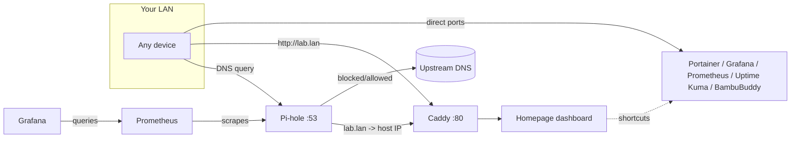

<p align="center">
  
</p>

<p align="center">
  
  
  
  
</p>

# fednet

A Docker Compose homelab stack: a reverse-proxied dashboard, network-wide ad
blocking, container management, metrics/monitoring, and a 3D-printer control
panel — all self-hosted on one box, reachable either over Tailscale or a
plain LAN hostname.

Nothing here is exposed to the public internet. Every service binds to the
host's LAN interface (or a Tailscale tailnet, if you set one up); there's no
port-forwarding, no cloud dependency, and no external accounts required to
run it.

## Table of contents

- [Stack overview](#stack-overview)
- [Architecture](#architecture)
- [Prerequisites](#prerequisites)
- [Setup](#setup)
  - [1. Clone and run one-time host setup](#1-clone-and-run-one-time-host-setup)
  - [2. Configure environment](#2-configure-environment)
  - [3. Start the stack](#3-start-the-stack)
  - [4. Give it a hostname](#4-give-it-a-hostname)
- [Service notes](#service-notes)
- [Dashboard customization](#dashboard-customization)
- [Adding a new service](#adding-a-new-service)
- [Commands](#commands)
- [Backups](#backups)
- [Troubleshooting](#troubleshooting)
- [Data & persistence](#data--persistence)

## Stack overview

| Service | Purpose | Default port |
|---|---|---|
| [Caddy](https://caddyserver.com/) | Reverse proxy, front door for the dashboard | `80`, `443` |
| [Homepage](https://gethomepage.dev/) | Dashboard with shortcuts to every service | behind Caddy on `80` |
| [Portainer](https://www.portainer.io/) | Container management UI | `9000` |
| [Pi-hole](https://pi-hole.net/) | Network-wide DNS ad blocking + local DNS records | `53` (DNS), `8081` (admin) |
| [Uptime Kuma](https://github.com/louislam/uptime-kuma) | Service uptime monitoring | `3001` |
| [Grafana](https://grafana.com/) | Dashboards for metrics | `3000` |
| [Prometheus](https://prometheus.io/) | Metrics collection | `9090` |
| [BambuBuddy](https://github.com/maziggy/bambuddy) | Self-hosted Bambu Lab 3D printer dashboard | `8000` (host networking) |

Every service except BambuBuddy sits on a shared external Docker network
(`edge`) and is published directly on the host's LAN ports — Caddy only
proxies the Homepage dashboard itself on port 80. BambuBuddy runs with
`network_mode: host` instead, because printer auto-discovery (SSDP) and its
RTSP camera proxy both need raw L2 network access a bridge network can't
provide.

## Architecture



## Prerequisites

- A Linux host on your LAN with [Docker](https://docs.docker.com/engine/install/) and the Compose plugin installed
- `make`
- Root/sudo on that host (Pi-hole binds port 53, Caddy binds 80/443)
- Optional: a [Tailscale](https://tailscale.com/) account, if you'd rather reach the stack over a tailnet than a LAN hostname

## Setup

### 1. Clone and run one-time host setup

```bash
git clone https://github.com/imfronto/homelab.git
cd homelab
./scripts/setup.sh
```

`scripts/setup.sh` creates the shared `edge` Docker network, the `data/`
subdirectories every service's volumes expect, and offers to install
Tailscale if it isn't already present. It's idempotent — safe to re-run.

### 2. Configure environment

```bash
cp .env.example .env
```

Then edit `.env`:

| Variable | Required | Notes |
|---|---|---|
| `TZ` | recommended | Your timezone, e.g. `America/New_York` |
| `PUID` / `PGID` | recommended | Match your host user so bind-mounted files aren't root-owned |
| `TAILSCALE_HOSTNAME` | if using Tailscale | Your tailnet MagicDNS name, e.g. `fednet` |
| `PIHOLE_PASSWORD` | **yes** | Pi-hole admin password — no default, container won't start without it |
| `GRAFANA_ADMIN_PASSWORD` | **yes** | Grafana admin password — see the [Troubleshooting](#troubleshooting) note if you're changing it on an existing volume |
| `GRAVITY_WEBHOOK_URL` | optional | Discord/Slack incoming webhook for blocklist-staleness alerts; leave as `changeme` to disable alerting |
| `GRAVITY_MAX_AGE_HOURS` | optional | Alert threshold if Pi-hole's blocklist hasn't refreshed (default `48`) |
| `BAMBUDDY_PORT` | optional | Port BambuBuddy's web UI listens on (default `8000`) |

### 3. Start the stack

```bash
make up
```

The Makefile globs every file in `services/*.yml` automatically, so this
starts the core stack (`docker-compose.yml`) plus Pi-hole, monitoring, and
BambuBuddy in one shot. First run pulls every image, so it can take a
few minutes.

Check everything came up healthy:

```bash
make ps
```

### 4. Give it a hostname

You have two options, and they aren't mutually exclusive.

**Option A — Tailscale (recommended for remote access):**

```bash
sudo tailscale up
```

Every service is then reachable at `http://<TAILSCALE_HOSTNAME>` (or
`:<port>` for anything other than the dashboard) from any device on your
tailnet, with no LAN configuration needed.

**Option B — a local hostname on your LAN (e.g. `lab.lan`):**

Since Pi-hole is already your DNS server, add a Local DNS Record instead of
relying on `/etc/hosts` on every device:

```bash
docker exec pihole sh -c '
SID=$(curl -skS -X POST "http://127.0.0.1/api/auth" --data "{\"password\":\"'"$PIHOLE_PASSWORD"'\"}" | jq -r .session.sid)
curl -skS -X PUT "http://127.0.0.1/api/config/dns/hosts/<HOST-LAN-IP>%20lab.lan" -H "sid: $SID"
'
```

(Or do the same thing from the Pi-hole admin UI: **Local DNS → DNS
Records**.) Then point your devices at Pi-hole for DNS — either set it
manually per-device, or point your router's DHCP DNS setting at the host's
LAN IP so every device on the network gets it automatically (and gets
ad-blocking for free). See [Troubleshooting](#troubleshooting) if `lab.lan`
doesn't resolve after this — there's a Pi-hole-in-Docker gotcha that bites
almost everyone who runs it in bridge mode.

## Service notes

**Pi-hole blocklists** — configured from
[blocklistproject/Lists](https://github.com/blocklistproject/Lists) plus
StevenBlack's hosts file:

- `https://raw.githubusercontent.com/StevenBlack/hosts/master/hosts`
- `https://blocklistproject.github.io/Lists/ads.txt`
- `https://blocklistproject.github.io/Lists/tracking.txt`
- `https://blocklistproject.github.io/Lists/malware.txt`
- `https://blocklistproject.github.io/Lists/phishing.txt`
- `https://blocklistproject.github.io/Lists/ransomware.txt`
- `https://blocklistproject.github.io/Lists/scam.txt`
- `https://blocklistproject.github.io/Lists/fraud.txt`
- `https://blocklistproject.github.io/Lists/redirect.txt`

blocklistproject also publishes lists that block entire platforms outright
(facebook.txt, youtube.txt, tiktok.txt, twitter.txt, whatsapp.txt, gambling,
porn, crypto, vaping, drugs, fortnite) — deliberately not added since they
break those apps/sites entirely rather than just stripping ads. Add via the
admin UI (**Domains → Adlists**) or the API, then `docker exec pihole
pihole -g` to apply.

Pi-hole's blocklist database (`gravity.db`) lives under `data/pihole/`,
which is git-ignored — a fresh checkout starts with none configured until
you add the lists above.

`gravity-watchdog` alerts if `gravity.db` hasn't refreshed in
`GRAVITY_MAX_AGE_HOURS` (default 48h), posting to `GRAVITY_WEBHOOK_URL`.
Point it at a real Discord/Slack incoming webhook to make it useful.

**BambuBuddy** — runs on host networking and auto-discovers any Bambu Lab
printer on your LAN with Developer Mode enabled. Open `http://<host>:8000`
(or your `lab.lan`/Tailscale hostname) and add your printer from the UI —
no config file entry needed. Data (job archives, settings) persists under
`data/bambuddy/`.

**Grafana / Prometheus** — reuse the pre-existing `pihole_grafana_data` and
`pihole_prometheus_data` Docker volumes (declared `external: true` in
`services/monitoring.yml`), so dashboards and metric history survive
redeploys. `make down` never removes external volumes, but they also won't
show up if you inspect this project alone — they aren't created by
anything here.

## Dashboard customization

Homepage's config lives entirely under `homepage/` and hot-reloads most
changes without a container restart:

- `homepage/services.yaml` — shortcuts, grouped, each with an optional
  `ping:` host for a live status dot (hostname/IP only — ICMP has no
  concept of ports, so `host:port` silently fails to parse)
- `homepage/settings.yaml` — theme, accent color, header style, card blur,
  group layout/columns
- `homepage/widgets.yaml` — the info-widget row (greeting, clock, resource
  usage, search bar)
- `homepage/custom.css` — the dark gradient background, grid texture, and
  card hover effects layered on top of the theme; auto-included by Homepage,
  no build step

## Adding a new service

1. Create `services/<name>.yml` with its own `services:` block, attach it
   to the external `edge` network, and give it persistent volumes under
   `./data/<name>` (unless it needs host networking, like BambuBuddy).
2. Add a shortcut for it in `homepage/services.yaml`, and a `layout:` entry
   in `homepage/settings.yaml` if it's a new group.
3. `make up` — the Makefile globs `services/*.yml` automatically, no other
   file needs to change.

## Commands

| Command | Effect |
|---|---|
| `make up` | Start/update everything |
| `make down` | Stop everything |
| `make restart` | Recreate everything |
| `make ps` | Show container status |
| `make logs` | Tail logs for all containers |
| `make pull` | Pull latest images |
| `make backup` | Snapshot everything git doesn't track (see [Backups](#backups)) |
| `make backup-list` | List existing snapshots |
| `make restore` | Restore the latest snapshot (`make restore SNAPSHOT=<id>` for a specific one) |

## Backups

`make backup` uses [restic](https://restic.net/) to snapshot everything
`.gitignore` excludes from version control — the actual state that a `git
clone` of this repo can't reconstruct:

- `./data/` — Caddy TLS state, Portainer, Uptime Kuma, Pi-hole's
  `etc-pihole`/`etc-dnsmasq.d`, BambuBuddy's job archives
- `.env` — every service password and config value
- the two external Docker volumes (`pihole_grafana_data`,
  `pihole_prometheus_data`) that Grafana and Prometheus use, since those
  live outside `./data` entirely

restic encrypts everything client-side before it leaves the host, dedupes
across runs, and keeps a history of snapshots rather than just the latest
copy — configured entirely through `.env`:

| Variable | Notes |
|---|---|
| `BACKUP_RESTIC_REPOSITORY` | Where snapshots go — a local path, `sftp:user@host:/path`, an S3-compatible bucket, or Backblaze B2. **A local path only protects against accidental deletion or corruption, not a dead disk** — point this somewhere off the host once you have a second disk or NAS available. |
| `BACKUP_RESTIC_PASSWORD` | Encrypts and authenticates the repo. restic cannot recover a lost password and neither can anyone else — keep a copy outside this repo (password manager), or every snapshot becomes unreadable. |
| `BACKUP_KEEP_DAILY` / `BACKUP_KEEP_WEEKLY` / `BACKUP_KEEP_MONTHLY` | Retention policy applied by `restic forget --prune` after each backup. Defaults: 7 daily, 4 weekly, 6 monthly. |

`scripts/backup.sh` runs restic inside the `restic/restic` container
rather than on the host — two reasons: Caddy and Portainer don't drop
privileges, so parts of `./data` are root-owned and unreadable by a
host-user restic; and mounting everything at fixed container-internal
paths (`/backup/data`, `/backup/env`, `/backup/volumes/...`) keeps
snapshot contents independent of this host's absolute paths, so restoring
isn't tied to this exact machine or directory. It also briefly stops the
whole stack (`make down` / `make up`) around the snapshot — Pi-hole's
`gravity.db`, Grafana and Uptime Kuma's SQLite files, and Prometheus's
TSDB all risk a corrupt copy if read mid-write, so a few seconds of
downtime beats a backup that fails to restore. No host install is needed
beyond Docker itself.

**Restore:**

```bash
make backup-list                  # find the snapshot id you want, or use "latest"
make restore                      # restores the latest snapshot in place
make restore SNAPSHOT=a1b2c3d4    # or a specific one
```

`make restore` stops the stack, restores `./data`, `.env`, and the two
Docker volumes from the snapshot, and brings the stack back up. Because
the snapshot's paths are container-internal, this works the same way
whether you're restoring in place after a bad config change or onto a
freshly cloned repo after losing the disk — just `git clone`, run
`./scripts/setup.sh`, put `.env` back (or leave the placeholder — restore
overwrites it from the snapshot anyway), and run `make restore`.

**Automate it** with a nightly cron job:

```bash
crontab -e
# 0 3 * * * cd /home/fronto/projects/homelab && ./scripts/backup.sh >> /home/fronto/backups/fednet-backup.log 2>&1
```

## Troubleshooting

**`lab.lan` (or any local DNS record) times out from LAN devices, but works
from the Pi-hole host itself** — Pi-hole defaults to `listeningMode: LOCAL`,
which only accepts queries from the container's own directly-attached
network. Since Pi-hole runs in a Docker bridge network, its only "local"
subnet from that setting's point of view is the internal Docker bridge, not
your real LAN — so it silently drops every query from actual devices. Fix:

```bash
docker exec pihole sh -c '
SID=$(curl -skS -X POST "http://127.0.0.1/api/auth" --data "{\"password\":\"'"$PIHOLE_PASSWORD"'\"}" | jq -r .session.sid)
curl -skS -X PATCH "http://127.0.0.1/api/config" -H "sid: $SID" -H "Content-Type: application/json" \
  --data "{\"config\":{\"dns\":{\"listeningMode\":\"ALL\"}}}"
'
```

**Port 53 (or 80/443) seems unreachable from other devices, even after the
above** — check whether `ufw` is active and blocking it:

```bash
sudo ufw status verbose
sudo ufw allow 53/tcp
sudo ufw allow 53/udp
```

**A device still can't resolve a hostname after the fixes above** — flush
its DNS cache; it's likely holding a cached failure from before the fix:

```bash
# macOS
sudo dscacheutil -flushcache; sudo killall -HUP mDNSResponder
# Windows
ipconfig /flushdns
# Linux (systemd-resolved)
resolvectl status   # confirm which DNS server the interface is actually using
resolvectl query <hostname>
```

**Changing `GRAFANA_ADMIN_PASSWORD` in `.env` doesn't change the login** —
the `GF_SECURITY_ADMIN_PASSWORD` environment variable only sets the admin
password the *first* time Grafana initializes its database. Since this
project reuses a pre-existing `pihole_grafana_data` volume, that's already
happened — updating `.env` and restarting the container has no effect on
its own. Reset the password directly instead:

```bash
docker exec -u root grafana grafana cli admin reset-admin-password '<new-password>'
```

(Keep `.env` in sync with whatever you set, so a from-scratch redeploy
matches.)

## Data & persistence

Every container's persistent state lives under `./data/<service>/` on the
host, which is entirely git-ignored — a fresh clone of this repo starts
with no service data, only configuration. `.env` is also git-ignored (only
`.env.example` is tracked) since it holds real passwords.
